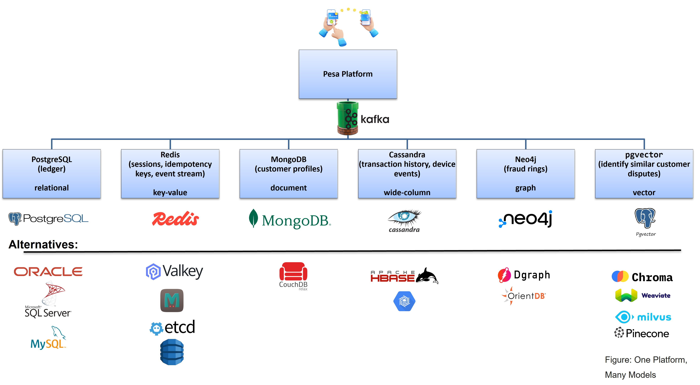

# Non-Relational Data Models

| Key             | Value                                                                                                                                                                                                                                                                           |
|:----------------|:--------------------------------------------------------------------------------------------------------------------------------------------------------------------------------------------------------------------------------------------------------------------------------|
| **Course Code** | MIT 8107                                                                                                                                                                                                                                                                        |
| **Course Name** | MIT 8107: Advanced Database Systems (Week 4-6)                                                                                                                                                                                                                                    |
| **Semester**    | September to December 2026                                                                                                                                                                                                                                                              |
| **Lecturer**    | Allan Omondi                                                                                                                                                                                                                                                                    |
| **Contact**     | aomondi@strathmore.edu                                                                                                                                                                                                                                                          |
| **Note**        | The lecture contains both theory and practice.<br/>This notebook forms part of the practice.<br/>It is intended for educational purposes only.<br/>Recommended citation: [BibTex](https://raw.githubusercontent.com/course-files/Kafka/refs/heads/main/RecommendedCitation.bib) |

## Running Scenario: Pesa Platform



Four laboratories for **Module 4: Non-Relational Data Models**. You work with one invented payments company, the **Pesa Platform**,
and learn five data models by using them together, the way a real system does.

| Lab | Topic | Stores | Time | Docker memory |
|---|---|---|---|---|
| **[Lab 1](lab_manuals/Lab1_Key-Value_and_Document_Models.md)** | Key-value and document models | Redis, MongoDB (+ PostgreSQL ledger) | 3.5 h | 4 GB |
| **[Lab 2](lab_manuals/Lab2_Wide-Column_Cassandra.md)** | Wide-column model | Cassandra, three nodes | 3 h | 10 GB |
| **[Lab 3](lab_manuals/Lab3_Operating_Distributed_Stores_The_Two_Incidents.md)** | The two incidents (Monzo and Stackdriver) | Cassandra (up to five nodes), Redis Streams, optional Kafka | 4.5 h (3 h on the simulator track) | 11 GB (4 GB on the simulator track) |
| **[Lab 4](lab_manuals/Lab4_Graph_and_Vector_Models_and_One_System.md)** | Graph and vector models, and **one system** | Neo4j, PostgreSQL + pgvector, then all five stores in the capstone | 5 h in two sittings | 4 GB (Parts A-F), 8 GB (capstone) |

Do them **in order**. Each lab builds on the one before, and the capstone in Lab 4 reuses what you built in Labs 1 to 3.

## What the module is really about

One rule runs through every lab: **the ledger stays in PostgreSQL**.

Every other store holds data shaped for **one** question. Ask the following question: *what query does it answer fast, what does it give up, and if it lost everything, how would I rebuild it?*

In a system that uses several databases, Kafka or Redis Streams acts as the glue by carrying an ordered record of every change from the producer or database that owns the data to the others. Each database, such as Cassandra, Neo4j or Redis, subscribes through its own consumer group and builds the view that suits its access pattern, so a slow or failed consumer never blocks the producer or the other consumers. Because the stream is retained, any view can be rebuilt by replaying it, and a new database can be added later without changing the source. The databases remain eventually consistent rather than instantly identical, so the design depends on atomic publishing (the outbox pattern) and idempotent consumers.

## What you need

* A laptop with **16 GB of RAM** (12 GB works for everything except the five-node part of Lab 3, which has a simulator alternative).
* **Docker Desktop** (Windows, macOS) or Docker Engine with the Compose plugin (Linux). About **8 GB of free disk** for the images.
* **Windows:** use Docker Desktop with the **WSL2** backend, and run all commands in a **WSL2 terminal or Git Bash** (the helper scripts are
  bash scripts). Unzip the pack inside your WSL2 home folder for good file speed.
* **macOS or Linux:** the Terminal.
* No database or Python needs to be installed on your computer. Everything runs in containers.

**Set Docker's memory limit.** Docker Desktop, *Settings*, *Resources*, *Memory*. Use **10 to 12 GB** on a 16 GB laptop.
That should be about **75% of your laptop's RAM** instead of the default 50%.
Click here for instructions on how to set Docker's memory limit: [Set Docker Memory Limit](0_admin_instructions/3_instructions_for_setting_docker_memory_limit.md)

**NOTE:** Close your browser tabs and other heavy applications while you run Cassandra.

## Quick start

```bash
# Windows (Git Bash) and Linux: remove Windows line endings from the helper scripts, then make them executable.
# (macOS: use  for f in scripts/*.sh; do tr -d '\r' < "$f" > "$f.tmp" && mv "$f.tmp" "$f"; done  instead of sed.)
sed -i 's/\r$//' scripts/*.sh .env
chmod u+x scripts/*.sh
bash scripts/check_prereqs.sh                  # checks Docker, memory, ports, disk
docker compose --profile lab1 up -d --build    # starts Lab 1 (the first run downloads images; allow 10 minutes)
docker compose ps                              # wait until the services say "healthy"
```

Then open **`lab_manuals/Lab1_Key-Value_and_Document_Models.md`** and follow it.

## How the pack is organised

```text
docker-compose.yml     all services, grouped into PROFILES (a profile is a named group you start together)
.env.example           image versions (pinned) and one switch used in Lab 1
app/                   the Python programs you run (and sometimes read or complete)
  pesa/                helper modules (connections, the stand-in embedding model)
  capstone/            the Lab 4 capstone: gateway, outbox relay, consumers, verifier
sql/                   creates and loads the PostgreSQL ledger (runs once, automatically)
queries/, cypher/      query files used in Lab 4
data/                  the synthetic data set (12,000 payments); a manifest lists the file hashes
scripts/               helper scripts (check_prereqs, reset_lab, verify, node_counts)
incident/              the incident descriptions for Lab 3
lab_manuals/           the four lab manuals: **READ THESE**
my_work/               your answer sheets and memos: **SUBMIT YOUR WORK HERE**
```

### The profiles

| Command | Starts | Used in |
|---|---|---|
| `docker compose --profile lab1 up -d` | PostgreSQL, Redis, MongoDB | Lab 1 |
| `docker compose --profile lab2 up -d` | Cassandra nodes `cass1`, `cass2`, `cass3` (started in order) | Lab 2 |
| `docker compose --profile lab3a up -d` | the same three nodes | Lab 3 Part A |
| `docker compose --profile joiners up -d cass4` | one extra node (names: `cass4`, `cass5`, `cass6`) | Lab 3 Part A |
| `docker compose --profile lab3b up -d` | Redis | Lab 3 Part B |
| `docker compose --profile kafka up -d` | Kafka (optional) | Lab 3 Part B2 |
| `docker compose --profile lab4 up -d` | PostgreSQL (with pgvector), Neo4j | Lab 4 Parts A-F |
| `docker compose --profile capstone up -d` | PostgreSQL, Redis, MongoDB, Cassandra (one node), Neo4j | Lab 4 Part G |

The `workbench` container (Python with every database driver) always starts. Run the lab programs **inside it**:

```bash
docker compose exec workbench python app/<script>.py
```

### Ports used on your computer (all bound to 127.0.0.1 only)

| Port | Service |
|---|---|
| 5440 | PostgreSQL |
| 6390 | Redis |
| 27040 | MongoDB |
| 9142 | Cassandra (`cass1`) |
| 7474 and 7687 | Neo4j Browser and Bolt |

If another program already uses one of these, `check_prereqs.sh` says so. Change the left-hand number in `docker-compose.yml`.

## How to work

* **Read the code and the comments.** Many scripts are short on purpose; the comments explain the mechanism.
* **IMPORTANT: Predict, then run.** Questions marked *Predict* are the most valuable part of each lab. Write your prediction first.
* **Write your answers in `my_work/`.** Each lab has an answer sheet. Lab 1, 2 and 4 each have a design memo; Lab 3 has two
  documents that are marked more heavily (a runbook and a pipeline design).
* **Check yourself.** `bash scripts/verify.sh 1` (or `2`, `3`, `4`, `capstone`) tests the state of your databases and whether your written
  work is present. It does **not** mark your answers.
* **Your work is your own.** Discuss the ideas, but write your answers and memos individually, in your own words.

## Useful commands

```bash
docker compose ps                                  # what is running
docker compose logs <service>                      # why did it fail?
docker compose --profile lab1 down                 # stop a lab, KEEP the data
bash scripts/reset_lab.sh                          # stop everything and DELETE all lab data
docker system df                                   # how much disk Docker uses
```

## Honest notes

* **The data is synthetic.** Names, phone numbers and merchants are synthetic. Merchant categories and amounts are plausible, not real.
* **The embedding model in Lab 4 is a stand-in.** It illustrates vector search without downloading a neural network, and the lab shows where
  it breaks. A real project would use a trained model.
* **Some experiments use real timers** (Redis Streams in Lab 3, benchmarks in Lab 4). Your numbers will differ slightly from the manual's.
  Compare the *pattern*.
* **Image versions are pinned in `.env`.** If a pull fails, tell me (your lecturer) rather than changing the versions.

## If something goes wrong

| Symptom | What to try |
|---|---|
| `docker: command not found` or the daemon is not running | start Docker Desktop and wait for "running" |
| "port is already allocated" | stop the other program or change the port (see above) |
| A Cassandra node never becomes healthy | raise Docker's memory; `docker compose logs <node>`; start again with `docker compose up -d` |
| A command with a path such as `/queries/...` or `/cypher/...` fails in Git Bash with a strange `C:/Program Files/Git/...` path | Git Bash rewrites Unix-style paths. Run `export MSYS_NO_PATHCONV=1` first (or use a WSL2 terminal, which does not have this problem) |
| `exec: bash\r: no such file` or similar on Windows | the files were unzipped with Windows line endings; unzip again inside WSL2 |
| Out of disk space | `docker system prune` (it removes stopped containers and unused images; your lab data volumes are kept) |
| Everything is confused | `bash scripts/reset_lab.sh` and begin the lab again |
